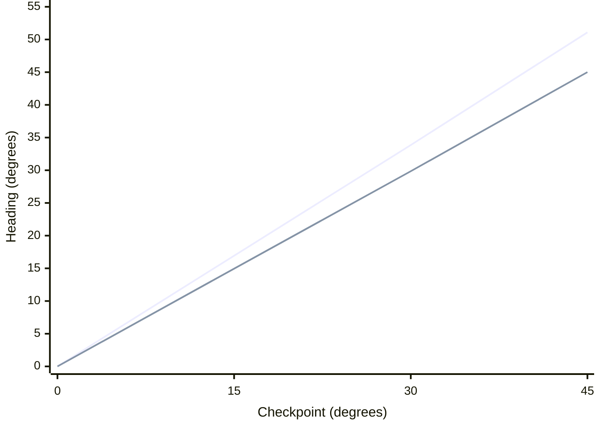

# Diagnosing Heading Error in a Differential-Drive Robot

**Experimental Investigation and Effective Wheel Separation Estimation**

**Project:** Round Robot (ROS 2 Jazzy + Gazebo Harmonic)  
**Experiment date:** 9 October 2026  
**Planned trajectory:** $(x,y,\theta)=(0,0,0) \rightarrow (1,1)$

> **Key finding**  
> Gazebo Ground Truth reported a final heading of **51.094745°**, whereas Clean Wheel Odometry reported **45.040216°**, a difference of **6.054529°**. If this discrepancy is represented by a single equivalent wheel-separation parameter, the inferred value is approximately **0.08815 m (8.82 cm)**, compared with a nominal separation of **0.10 m**. This is a calibration hypothesis, **not** a direct measurement of the robot's mechanical wheel separation.

## 1. Experimental Setup and Parameters

The robot uses a differential-drive mechanism. Its motion controller executes a *turn-then-drive* plan based on measured wheel rotations:

1. Turn approximately **45°** in place.
2. Drive straight for a planned distance of $\sqrt{2} \approx 1.4142\,\mathrm{m}$ toward $(1,1)$.

The experiment records three independently defined pose trajectories:

- **Clean Odometry:** Pose integrated from wheel-joint angles without artificially injected measurement noise.
- **Noisy Odometry:** The same wheel-based estimate with additional Gaussian noise on incremental distance and heading.
- **Gazebo Ground Truth:** Simulated body pose, accessed **only for evaluation** and not for motion control or odometry correction.

| Parameter | Value / source |
|---|---|
| Nominal wheel separation, $b_{\mathrm{nom}}$ | $0.10\,\mathrm{m}$ (`config/robot.yaml`; Gazebo DiffDrive) |
| Left/right wheel radii, $r_L$, $r_R$ | $0.025\,\mathrm{m}$ each |
| Pose estimation input | `/joint_states`; left/right measured wheel rotation |
| Ground-truth input | `/ground_truth` (evaluation only) |
| Injected distance noise, per moving sample | $\sigma_s = 0.0002\,\mathrm{m}$ |
| Injected heading noise, per moving sample | $\sigma_\theta = 0.001\,\mathrm{rad}$ |
| Random seed | `42` |
| Timestamp-matched samples | **1,457** |

**Configuration references:** `config/robot.yaml`, `Round_Robot/models/round_robot/model.sdf`, `config/experiment.yaml`; Intelligent Robotics Week 2 lecture, *Sensing – Odometry*, slides 25, 29, 31, and 33.

## 2. Initial Observation: Large Localization RMSE Despite Small Added Noise

| Metric | Recorded value | Interpretation |
|---|---:|---|
| Clean RMSE | $0.082983\,\mathrm{m}$ (**8.30 cm**) | Substantial error even without injected noise |
| Noisy RMSE | $0.086259\,\mathrm{m}$ (**8.63 cm**) | Slightly larger than Clean RMSE |
| Noisy–Clean endpoint difference | $0.015280\,\mathrm{m}$ (**1.53 cm**) | Separation between the two estimated final positions |
| Final noisy localization error | $0.164427\,\mathrm{m}$ (**16.44 cm**) | Final noisy estimate versus Ground Truth |
| Noisy trajectory MSE | $0.00744059\,\mathrm{m}^2$ | Mean squared planar localization error |

Position error at sample $i$ is defined as

$$
e_i = \sqrt{(x_{\mathrm{est},i}-x_{\mathrm{GT},i})^2 + (y_{\mathrm{est},i}-y_{\mathrm{GT},i})^2}.
$$

The two aggregate metrics are

$$
\mathrm{MSE} = \frac{1}{N}\sum_{i=1}^{N} e_i^2,
\qquad
\mathrm{RMSE} = \sqrt{\frac{1}{N}\sum_{i=1}^{N}e_i^2}.
$$

**Initial interpretation:** The Clean Odometry RMSE is already about 8.30 cm. Hence, the observed error cannot be attributed solely to the added Gaussian measurement noise. The difference between the Clean and Noisy RMSE values should **not** be interpreted as a complete measure of the effect of noise.

## 3. Step-by-Step Diagnosis of the Error Source

### 3.1. Compare heading error at the beginning and end of DRIVE

To approximate the start of forward motion, the analysis selected the first sample for which the Clean Odometry position was more than $0.01\,\mathrm{m}$ from its initial position. This threshold identifies a diagnostic checkpoint; it is **not a navigation stopping tolerance**.

Define wrapped heading discrepancy as

$$
\epsilon_\theta = \operatorname{wrap}(\theta_{\mathrm{GT}} - \theta_{\mathrm{clean}}).
$$

| Observation | Heading difference (GT − Clean) | Meaning |
|---|---:|---|
| Near start of DRIVE | **+6.054528967°** | Error already present before appreciable straight-line travel |
| End of run | **+6.054528902°** | Essentially unchanged |
| Additional discrepancy during DRIVE | $\approx -0.000000065^\circ$ | Negligible additional heading drift |

**Diagnostic finding:** The discrepancy was already present near the transition to straight driving. This points to the **TURN phase** as its principal origin, although reference-frame conventions and timestamp alignment must still be checked.

### 3.2. Inspect checkpoints during the in-place turn

The next check compared Ground Truth and Clean Odometry at approximately 0°, 15°, 30°, and 45° of estimated turning. Because the console printed only four decimal places for some values, precise Clean Odometry headings in the following table are reconstructed from **Ground Truth − Reported Error** and should not be treated as higher-precision measurements.

| Checkpoint | Clean heading (reconstructed) | Ground Truth | GT − Clean |
|---|---:|---:|---:|
| Approx. 0° | 0.0000° | 0.0000° | 0.0000° |
| Approx. 15° | 14.9542° | 16.9305° | +1.9763° |
| Approx. 30° | 29.8511° | 33.8586° | +4.0075° |
| Approx. 45° | 45.0087° | 51.0828° | +6.0741° |

**Figure 1. Reconstructed heading comparison from the four diagnostic checkpoints**

*The first line represents Gazebo Ground Truth; the second represents reconstructed Clean Odometry. The chart shows four checkpoints, not the full high-frequency trajectory. If the Markdown previewer does not support Mermaid XY charts, use the table above.*

> **Evidence chain:** The initial heading discrepancy is 0°. It increases to approximately 1.98°, 4.01°, and 6.07° throughout TURN, nearly in proportion to the turning angle. It remains almost constant during DRIVE. Thus, the principal mismatch is between actual body rotation and wheel-integrated rotation during the turn.

## 4. Mathematical Derivation of Effective Wheel Separation

### 4.1. Differential-drive equations from Week 2

The Week 2 *Sensing – Odometry* lecture describes the robot-centre displacement $\Delta s$ and heading increment $\Delta\theta$ using left and right wheel travel distances, $\Delta s_L$ and $\Delta s_R$:

$$
\boxed{\Delta s = \frac{\Delta s_R+\Delta s_L}{2}}
$$

$$
\boxed{\Delta\theta = \frac{\Delta s_R-\Delta s_L}{b}}
$$

Here, $b$ is wheel separation. Wheel displacement is calculated from wheel-angle increments:

$$
\Delta s_L = r_L\Delta\phi_L,\qquad
\Delta s_R = r_R\Delta\phi_R.
$$

Consequently, Clean Odometry calculates heading change as

$$
\Delta\theta_{\mathrm{clean}} =
\frac{r_R\Delta\phi_R-r_L\Delta\phi_L}{b_{\mathrm{nom}}}.
$$

### 4.2. Introduce an equivalent wheel-separation parameter

The following is an **equivalent-parameter hypothesis**, not proof of an incorrect mechanical dimension.

Assume the same measured difference in wheel travel,

$$
D = \Delta s_R-\Delta s_L,
$$

explains both the integrated wheel-odometry turn and the measured physical body rotation. We can write

$$
\Delta\theta_{\mathrm{clean}}=\frac{D}{b_{\mathrm{nom}}},
\qquad
\Delta\theta_{\mathrm{GT}}=\frac{D}{b_{\mathrm{eff}}}.
$$

Eliminating $D$ gives

$$
\boxed{b_{\mathrm{eff}} = b_{\mathrm{nom}}\frac{\Delta\theta_{\mathrm{clean}}}{\Delta\theta_{\mathrm{GT}}}}
$$

Both initial headings were approximately zero, and there was negligible further heading discrepancy during DRIVE. Using the accumulated reported headings,

$$
\begin{aligned}
b_{\mathrm{eff}}
  &= 0.10\,\mathrm{m}\times\frac{45.040216^\circ}{51.094745^\circ}\\[4pt]
  &\approx \boxed{0.08815039\,\mathrm{m}}\\[4pt]
  &\approx \boxed{8.82\,\mathrm{cm}}.
\end{aligned}
$$

The degrees cancel in the ratio; the inferred separation retains units of metres.

### 4.3. Equivalent rotational scale factor

The reciprocal relationship gives the actual-to-estimated rotation scale:

$$
k = \frac{\Delta\theta_{\mathrm{GT}}}{\Delta\theta_{\mathrm{clean}}}
   = \frac{51.094745}{45.040216}
   \approx \boxed{1.134425}.
$$

The model therefore exhibits an **approximately 13.44% greater actual body rotation than predicted by Clean Odometry** for this trial:

$$
(k-1)\times 100\% \approx 13.44\%.
$$

Estimates from the intermediate checkpoints are broadly consistent:

| Checkpoint | Approximate $b_{\mathrm{eff}}$ | Comment |
|---|---:|---|
| ~15° | 0.08833 m | More sensitive to sampling and displayed precision |
| ~30° | 0.08816 m | Close to overall estimate |
| ~45° | 0.08811 m | Close to overall estimate |
| Final accumulated headings | **0.08815 m** | Reference estimate for this trial |

> **Important limitation:** $b_{\mathrm{eff}}\approx0.08815\,\mathrm{m}$ is **not** a measurement of the actual mechanical wheel spacing, which remains nominally $0.10\,\mathrm{m}$. Lateral wheel slip, wheel–ground contact, caster-ball constraints, wheel-radius assumptions, frame definitions, or timing effects could all be absorbed into a single equivalent parameter. One trajectory does not uniquely identify the underlying physical cause.

## 5. Relating Heading Error to Endpoint Position Error

After TURN, the recorded Ground Truth and Clean Odometry headings differ by approximately

$$
|\epsilon_\theta| = 6.05453^\circ.
$$

Suppose two paths start at the same point and travel the same distance $d$, but in directions that differ by $|\epsilon_\theta|$. The exact separation of their endpoints under these simplifying assumptions is

$$
\boxed{e_{\mathrm{angular}}=2d\sin\left(\frac{|\epsilon_\theta|}{2}\right)}.
$$

Using the planned straight-line distance $d=\sqrt{2}\,\mathrm{m}$,

$$
\begin{aligned}
e_{\mathrm{angular}}
 &=2(1.4142)\sin\left(\frac{6.05453^\circ}{2}\right)\\
 &\approx \boxed{0.149\,\mathrm{m}=14.9\,\mathrm{cm}}.
\end{aligned}
$$

This is reasonably close to the recorded **16.44 cm** final noisy localization error. The estimate is illustrative rather than an exact decomposition: actual travel distance, possible position offsets, contact slip, timestamp matching, and injected noise may also contribute.

## 6. Conclusions, Limitations, and Validation Experiments

### 6.1. Findings supported by the recorded data

- The principal heading discrepancy emerges during **TURN**: roughly 6.05° is already present when DRIVE begins and is almost unchanged thereafter.
- The heading discrepancy grows approximately in proportion to the in-place turn angle, rather than being a fixed nonzero initial offset.
- Clean Odometry has **8.30 cm RMSE** even without additional injected Gaussian noise, indicating substantial model-related localization discrepancy.
- If represented by a single equivalent wheel-separation parameter, this run implies **$b_{\mathrm{eff}}\approx8.82\,\mathrm{cm}$**. This requires independent validation before use for calibration.

### 6.2. Recommended validation experiments

**Keep the original model parameters unchanged during the initial tests.**

| Test | Procedure | Purpose |
|---|---|---|
| A. Isolated TURN | Repeat left turns of 30°, 45°, and 90° | Check whether the actual/estimated angular ratio is stable |
| B. Reverse-direction TURN | Compare +45° left versus −45° right at the same speed | Detect left/right asymmetry or direction-dependent friction |
| C. Straight-only baseline | Move ~1 m along the x-axis without intentional rotation | Detect unexpected yaw during straight movement |
| D. Zero-noise repeat | Set $\sigma_s=0$ and $\sigma_\theta=0$ | Verify whether the dominant discrepancy persists without injected noise |
| E. Held-out calibration test | Infer $b_{\mathrm{eff}}$ from some runs and evaluate on separate trajectories | Test whether the inferred calibration generalizes |

Additional diagnostic checks should verify reference-frame origins and axes, time synchronisation between `/joint_states` and `/ground_truth`, the presence of exactly one DiffDrive system, and the effects of driving-wheel and front/rear ball-contact mechanics.

## 7. Report-Ready Summary

> In a turn-then-drive experiment, the difference between Clean Wheel Odometry and Gazebo Ground Truth increased approximately linearly throughout the in-place turn, reaching about **6.05°** following an estimated **45°** rotation. This discrepancy barely changed during the subsequent straight drive. Applying the Week 2 differential-drive kinematic relationship under an equivalent-separation hypothesis gives an effective wheel separation of approximately **0.08815 m**, compared with the nominal **0.10 m**. The findings indicate a systematic mismatch between wheel-based kinematic estimation and physical body rotation. Its underlying cause remains to be verified using reverse-direction turns, independent calibration trajectories, and frame-consistency checks.

---

### Sources and reproducibility

- **Course notes:** *Intelligent Robotics — Lecture 2: Sensing & Odometry*, slides 24–25, 29, and 31–33.
- **Experiment log:** `../results/old/localization_20261009_230014_130403.csv`, run on 9 October 2026; **1,457 matched records**.
- **Relevant project files:** `src/localization/odometry_uncertainty.py`, `src/localization/localization_metrics.py`, `src/controller/robot_auto_controller.py`, `config/robot.yaml`, `config/experiment.yaml`, and `Round_Robot/models/round_robot/model.sdf`.
- **Figure 1:** Reconstructed from the four diagnostic checkpoints printed in the terminal; the table retains the reported numerical precision.
